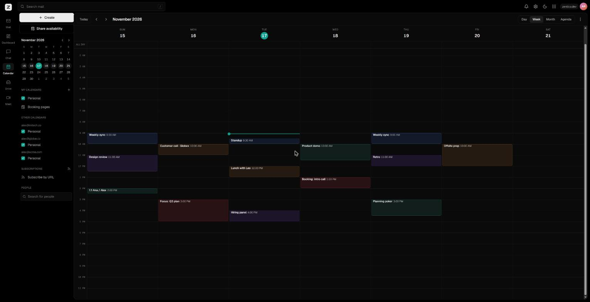
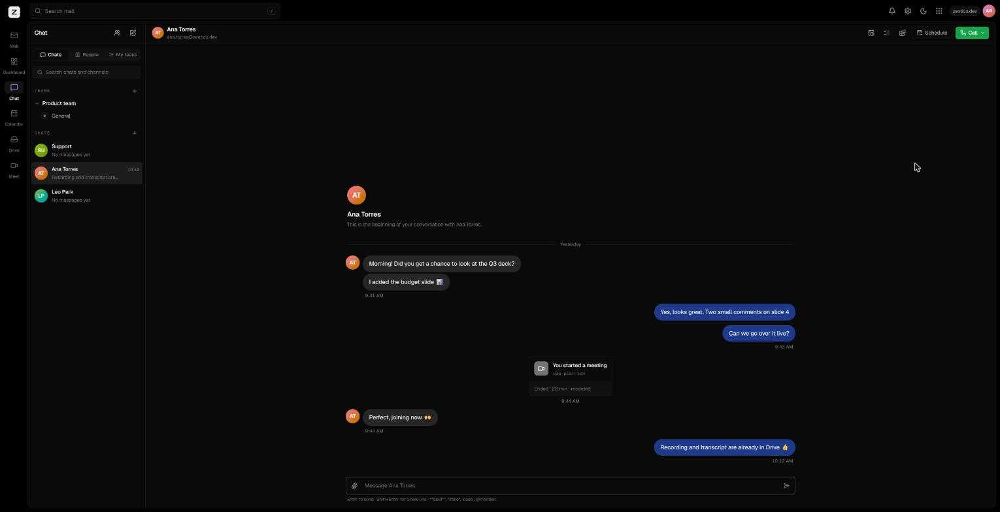
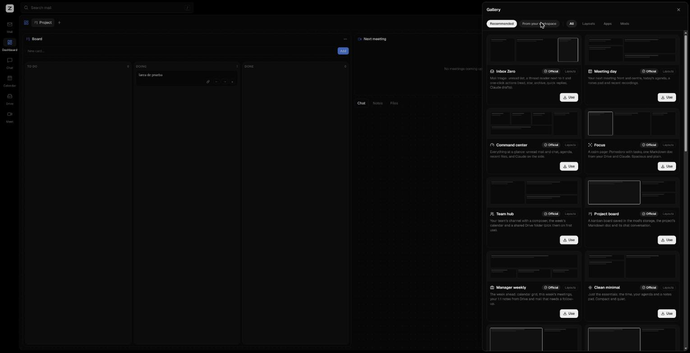
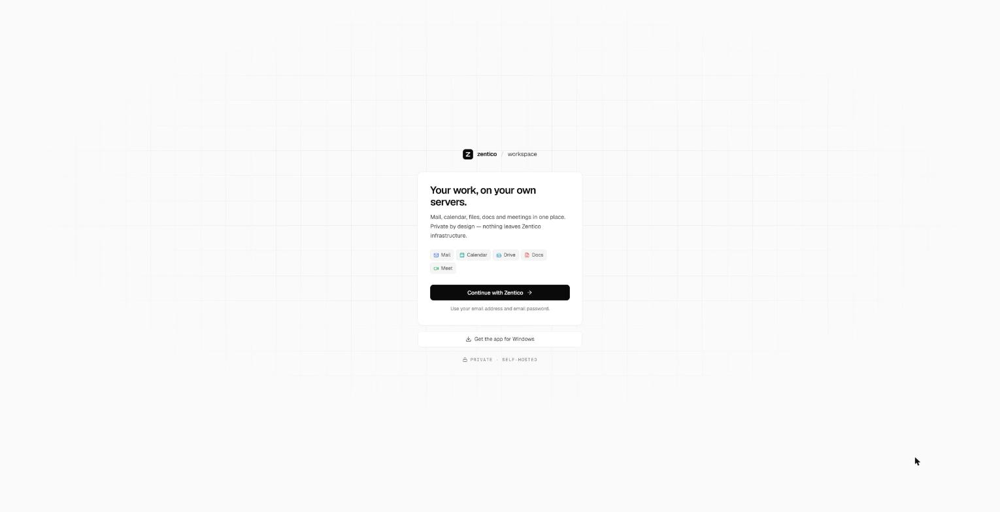
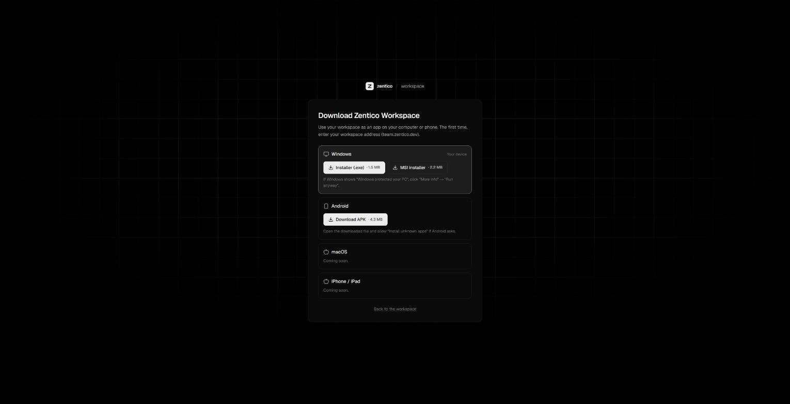
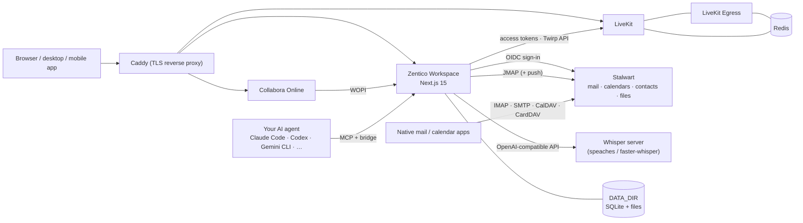

<div align="center">

<picture>
  <source media="(prefers-color-scheme: dark)" srcset="docs/assets/logo-animated-dark.svg">
  
</picture>

# Zentico Workspace

**A self-hosted workspace — mail, calendar, contacts, Drive, docs, chat and meetings — on top of
Stalwart, LiveKit and Collabora, with your own AI agent (Claude Code, Codex, Gemini CLI, …) built in
through MCP.**

[Website](https://www.zentico.dev/zentico-workspace) · [Self-hosting](#self-hosting) · [License (MIT)](LICENSE)


</div>

Zentico Workspace is the product layer only: it does not replace your mail, video or office
servers. [Stalwart](https://stalw.art) stores mail, calendars, contacts and files and handles
sign-in (OIDC); [LiveKit](https://livekit.io) carries meetings; [Collabora Online](https://www.collaboraoffice.com)
edits office documents. This Next.js app talks to them on the user's behalf and adds what they
don't have: chat, booking pages, a programmable dashboard, meeting transcripts and an
integration with your own AI agent. English and Spanish UI.

## Screenshots

| | |
| --- | --- |
|  |  |
| **Mail** | **Calendar** |
|  |  |
| **Chat** | **Dashboard** |
|  |  |
| **Sign-in** | **Desktop and mobile apps** |

<sub>Screenshots use demo data.</sub>

## Features

### Mail
- Threaded conversations, sanitized HTML in a sandboxed frame, remote images blocked by default.
- Compose, reply, forward, rich text, attachments, autosaved drafts, send-as identity per domain.
- Archive / spam / move / star, labels, multi-select, unified inbox across accounts, full-text search.
- Live updates over JMAP push, keyboard shortcuts (`c`, `r`, `a`, `f`, `e`, `j`/`k`, `/`, `?`…).
- Signatures, vacation responder and Sieve filters in settings.

### Calendar
- Day, week, month and agenda views; drag to create and move; time zones and reminders.
- Guests, invitations and RSVPs over iTIP/iMIP; one-click video meeting on any event.
- **Booking pages** (Calendly-style): public pages per meeting type, free/busy only (never event
  details), double-booking protection, confirmation mail with an `.ics` invite, manage/cancel links.
- **Subscriptions**: subscribe to external calendars by ICS URL (feed URLs stored encrypted) and
  import `.ics` files.

### Contacts
- Address books, groups, search, quick-compose, autocomplete in mail, export.

### Drive and Docs
- Files and folders on Stalwart (JMAP FileNode), uploads with progress, previews.
- Documents, spreadsheets and presentations in **Collabora Online** (this app is the WOPI host).
- Markdown documents and an Excalidraw whiteboard.

### Chat
- DMs, groups and teams with public/private channels; threads, reactions, mentions, edits, unread state.
- Attachments, Drive file sharing, **shared tasks** with assignees, due dates and subtasks.
- Ringing **calls** and "Meet now" in any conversation; scheduling straight into the calendar.
- Bots and apps: HTTP apps, incoming webhooks, and each person's own AI agent (@-mention it in a conversation).

### Meet
- LiveKit video meetings: pre-join, grid/speaker layouts, screen share, in-call chat, shareable links.
- **Recordings** (audio, and video through LiveKit Egress) with **transcripts** from a self-hosted
  Whisper server.
- **Voice commands to your agent** ("Codex, …", "Claude, …", "Assistant, …"): opt-in per participant;
  a command only reaches the speaker's own agent, and writes need the speaker's confirmation. The wake
  word follows the user's agent or a name they choose. Speech can be transcribed in the browser
  (WebGPU) so only text leaves the device.

### Dashboard and mods
- The Dashboard is built from plain files in the user's own Drive (`Zentico UI/`): layout, theme,
  keyboard shortcuts, widgets and **mods** (sandboxed HTML/CSS/JS with a permissioned `zentico.*` SDK).
- Validated on every change with undo snapshots; a workspace gallery of layouts and mods; an
  optional workspace-wide theme.
- Mods can call the user's connected MCP servers through the host, with per-tool consent
  (see [docs/user-mcp.md](docs/user-mcp.md)).

### AI agents and MCP
- A remote **MCP server** at `/api/mcp` (Streamable HTTP) exposing mail, calendar, contacts, Drive,
  docs, chat, tasks, meetings and dashboard tools. Any MCP client can use it: Claude Code, Codex,
  OpenCode, Gemini CLI, Cursor, VS Code…
- Personal access tokens (read or read+write, optional expiry, shown once, stored hashed) with rate
  limits and an audit log, created in **Settings → Integrations**, which also generates a setup prompt for each agent.
- A local **bridge** (`tools/zentico-bridge.mjs`, Node 18+, no dependencies) runs the user's own
  agent for meeting voice commands, Chat mentions and the Dashboard chat — no server-side agent.
  `--agent` picks Claude Code (default), Codex, OpenCode, Gemini CLI or any other CLI, or runs
  straight against an OpenAI-compatible or Anthropic API with the user's own key (no CLI needed).
- **Connected apps**: GitHub, Google, Atlassian, Notion and Slack via OAuth, and any remote MCP server
  the user adds.

### Security
- One login: the user's email address and password, through OIDC (authorization code + PKCE) against Stalwart.
- OAuth tokens never reach the browser; the session is an AES-GCM encrypted, httpOnly cookie.
- Two-step verification (TOTP, enforced by Stalwart) and app passwords; admins can require 2FA for everyone.
- Secrets at rest (feed URLs, refresh tokens, bot signing secrets) are sealed with AES-256-GCM;
  API tokens are stored as SHA-256 hashes.

### Desktop and mobile
- Thin native shells around your workspace URL: **Tauri v2** for Windows/macOS and **Capacitor 8**
  for Android/iOS, with native notifications. See [apps/README.md](apps/README.md).

## Architecture



- The app keeps its own state in SQLite files under `DATA_DIR` (Node's built-in `node:sqlite`):
  chat, meetings, MCP tokens, booking pages, calendar subscriptions, dashboard, security policy.
- Live features (chat, notifications, calls) use an in-process event bus over SSE, so **run a
  single app instance**.
- Collabora reaches the app's WOPI endpoint (`/api/wopi`); when Collabora only allows another host,
  set `WOPI_BASE_URL` to a proxied path on that host (for example on a Nextcloud domain).

## Tech stack

Next.js 15 (App Router, standalone output) · React 19 · TypeScript (strict) · Tailwind CSS 4 ·
next-intl · `node:sqlite` · `@modelcontextprotocol/sdk` · `livekit-client` · Excalidraw ·
transformers.js (in-browser Whisper) · Tauri v2 · Capacitor 8.

## Self-hosting

[`deploy/`](deploy) holds a reference deployment for one server: Docker Compose with the app,
Stalwart (mail, calendar, contacts, files and sign-in), LiveKit + Egress + Redis (Meet and
recordings), Caddy (HTTPS) and, optionally, Collabora Online (Docs) and a Whisper server
(transcripts). It needs a server with a public IPv4, 4 GB of RAM or more (8 GB with Collabora and
Whisper) and a domain whose DNS you control. Below, `example.com` stands for your domain.

| Host | Service |
| --- | --- |
| `team.example.com` | this app |
| `mail.example.com` | Stalwart (web admin, OIDC issuer, JMAP) |
| `meet.example.com` | LiveKit |
| `office.example.com` | Collabora (optional) |

### Quick install

On a fresh Ubuntu 22.04/24.04 server:

```bash
git clone https://github.com/antonyjaen/zentico-workspace.git
cd zentico-workspace
sudo ./deploy/install.sh            # or: --domain example.com --email you@example.com --yes [--office] [--whisper]
```

The script installs Docker (from Docker's apt repository) if needed, generates every secret,
writes `deploy/.env` and `deploy/workspace.env` and renders the Caddy, LiveKit and Egress configs,
prints the DNS records and waits until they resolve, opens the ports in `ufw` when it is active,
starts everything and checks that it answers. It is safe to re-run: existing secrets and files are
kept. It then prints the remaining manual steps, which are steps 4–6 below (Stalwart setup and its
OIDC client).

To let an AI agent with SSH access do it for you, give it the prompt in
[`deploy/SETUP_PROMPT.md`](deploy/SETUP_PROMPT.md).

### Manual install

**1. DNS.** Create `A` records for `team`, `mail`, `meet` (and `office`) pointing at the server,
plus the mail records: `MX example.com → 10 mail.example.com`, `TXT example.com "v=spf1 mx -all"`,
a DMARC record at `_dmarc.example.com`, and later the DKIM record Stalwart shows. Set the server's
reverse DNS (PTR) to `mail.example.com`.

**2. Firewall.** Open TCP 80, 443, 25, 465, 587, 993 (mail clients), 7881 and UDP 7882 (LiveKit media).

**3. Configuration.** In `deploy/`, copy each example and fill it in; secrets must match where noted:

```bash
cd deploy
cp .env.example .env                       # DOMAIN, ACME_EMAIL, STALWART_RECOVERY_ADMIN, COMPOSE_PROFILES
cp workspace.env.example workspace.env     # the app's environment (see the root .env.example)
cp Caddyfile.example Caddyfile             # replace example.com; drop the office block without Collabora
cp livekit.yaml.example livekit.yaml       # keys: <LIVEKIT_API_KEY>: <LIVEKIT_API_SECRET>
cp egress.yaml.example egress.yaml         # the same key and secret
mkdir -p stalwart/etc && cp stalwart-config.json stalwart/etc/config.json
sudo chown -R 2000:2000 stalwart           # Stalwart runs as uid 2000
chmod 600 .env workspace.env livekit.yaml egress.yaml

openssl rand -hex 16    # Stalwart admin password  → STALWART_RECOVERY_ADMIN=admin:<password>
openssl rand -hex 32    # SESSION_SECRET
openssl rand -hex 32    # LIVEKIT_API_SECRET (LIVEKIT_API_KEY: any short id, e.g. "ZW" + openssl rand -hex 8)
openssl rand -hex 32    # OIDC_CLIENT_SECRET (or use the secret Stalwart generates in step 5)
```

Optional services are Compose profiles: `COMPOSE_PROFILES=office,whisper` in `deploy/.env`. With
`office`, set `COLLABORA_URL=https://office.example.com` in `workspace.env` (Collabora only accepts
documents from `team.example.com`); with `whisper`, set `WHISPER_URL=http://whisper:8000` (the
model is `WHISPER_MODEL`, the language hint `WHISPER_LANGUAGE`).

**4. Start.**

```bash
docker compose up -d --build
docker compose ps
```

**5. Stalwart.** Open `https://mail.example.com/admin` and sign in as `admin` with the password
from `STALWART_RECOVERY_ADMIN`. Set the server hostname to `mail.example.com`, add your domain and
publish the DKIM record it shows, and create the user accounts. For TLS on the mail ports, point
Stalwart's certificate at `/opt/stalwart/certs/fullchain.pem` and `/opt/stalwart/certs/privkey.pem`;
`sudo ./install.sh --sync-certs` copies Caddy's `mail.example.com` certificate there (the quick
install runs it daily from cron).

**6. OIDC client.** In Stalwart, create an OAuth client for the app:

- **Client ID**: `zentico-workspace` (→ `OIDC_CLIENT_ID`), with the client secret from
  `OIDC_CLIENT_SECRET` in `workspace.env` (if Stalwart generates one instead, copy it there and run
  `docker compose up -d workspace`).
- **Redirect URI**: `https://team.example.com/api/auth/callback`.
- **Scopes**: `openid`, `offline_access`, `urn:ietf:params:oauth:scope:mail`, `…:contacts`,
  `…:calendars`, `…:files`, and Stalwart's **security** scope (two-step verification, app
  passwords, MCP tokens and booking pages).

Then sign in at `https://team.example.com` with a Stalwart account.

### Configuration reference

Required in `workspace.env`:

| Variable | Description |
| --- | --- |
| `OIDC_ISSUER` | Stalwart's public URL, e.g. `https://mail.example.com` |
| `OIDC_CLIENT_ID` / `OIDC_CLIENT_SECRET` | the client from step 6 |
| `APP_URL` | public URL of this app, e.g. `https://team.example.com` |
| `SESSION_SECRET` | random string of at least 32 characters (`openssl rand -hex 32`) |

Optional: `LIVEKIT_URL` / `LIVEKIT_API_KEY` / `LIVEKIT_API_SECRET`, `EGRESS_ENABLED`,
`COLLABORA_URL`, `WOPI_BASE_URL`, `WHISPER_URL` / `WHISPER_MODEL` / `WHISPER_LANGUAGE`, `DATA_DIR`,
`CHAT_DB_PATH`, `CHAT_FILES_DIR`, `WORKSPACE_ADMINS`, `ORG_DOMAINS`, `DRIVE_LINK_HOSTS`, `BUILD_ID`
and the `CONNECT_<PROVIDER>_CLIENT_ID` / `_SECRET` pairs for connected apps. Each is documented in
[`.env.example`](.env.example).

### Backups

Recommended for every server. [`deploy/backup.sh`](deploy/backup.sh) archives the mail store
(Stalwart is paused for a few seconds for a consistent copy), every SQLite database through
`.backup`, the config files and, if present, Nextcloud AIO (files plus a `pg_dump`). The installer
schedules it nightly at 03:30 server time and keeps the last 7 archives in
`/var/backups/zentico-workspace`.

A copy on the same disk doesn't survive losing the server, so add an encrypted off-site copy. With
Google Drive (15 GB free) and [rclone](https://rclone.org):

```bash
# 1. Authorize Google Drive. Run this from your own computer so the browser step works over SSH:
#    It prints only the sign-in link (never the token); open it, approve, and the command returns.
ssh -L 53682:127.0.0.1:53682 you@server \
  'sudo rclone config create gdrive drive scope=drive.file 2>&1 | grep --line-buffered -o "http://127.0.0.1:53682/auth[^ ]*"'
#    scope=drive.file means rclone only sees the files it creates, not the rest of your Drive.

# 2. Encrypt everything before it leaves the server (Google only stores ciphertext):
P1=$(openssl rand -hex 20); P2=$(openssl rand -hex 20)
sudo rclone config create gcrypt crypt remote=gdrive:zentico-backup \
  password=$(rclone obscure "$P1") password2=$(rclone obscure "$P2") >/dev/null
echo "password=$P1 password2=$P2" | sudo tee /root/backup-secret.txt >/dev/null; sudo chmod 600 /root/backup-secret.txt

# 3. Point the backup at it and run it once:
cat <<'EOF' | sudo tee deploy/backup.env
RCLONE_REMOTE=gcrypt:
KEEP_DAYS=30
ALERT_EMAIL=you@example.com
ALERT_FROM=backup@example.com
EOF
sudo deploy/backup.sh && sudo rclone ls gcrypt:
```

Store the two crypt passwords from `/root/backup-secret.txt` somewhere outside the server (a
password manager): without them the off-site copy can't be decrypted. Any other rclone remote (S3,
Backblaze B2, another server over SFTP) works the same way. `ALERT_EMAIL` gets a mail through the
local Stalwart whenever a run fails.

To restore: `rclone copy gcrypt:zw-backup-<date>.tar.gz .`, extract it, then put `stalwart/`,
`data/<service>/` (into the service's `/app/data` volume) and `config/` back with the services
stopped; Nextcloud's database restores with `psql` from `nextcloud/database.sql.gz`.

### Running the image on its own

If you already run Stalwart and the other services, you can run just the app:

```bash
docker build -t zentico-workspace .
docker run -d --name zentico-workspace \
  --env-file .env \
  -v zentico-data:/app/data \
  -p 3000:3000 \
  zentico-workspace
```

The image is a Next.js standalone build on `node:24-alpine`, runs as a non-root user and listens
on port 3000. Mount a persistent volume at `/app/data` (the default `DATA_DIR`). Put it behind your
TLS proxy at the `APP_URL` host.

## Development

Requires Node.js 24 (the app uses the built-in `node:sqlite` module) and a reachable Stalwart server
with an OIDC client whose redirect URI is `http://localhost:3000/api/auth/callback`.

```bash
npm install
cp .env.example .env.local   # then fill in the required values
npm run dev                  # http://localhost:3000 (Turbopack)
```

| Script | |
| --- | --- |
| `npm run dev` | development server |
| `npm run build` / `npm start` | production build / server |
| `npm run typecheck` | `tsc --noEmit` |
| `npm run lint` | `next lint` |

Project layout: `src/app` (routes and API), `src/lib` (server logic per area), `src/components`,
`messages/` (EN/ES translations), `tools/` (the agent bridge), `scripts/` (maintenance scripts),
`apps/` (desktop and mobile shells), `docs/`.

## Desktop and mobile apps

The native apps are thin shells that ask for the workspace URL on first launch. Build instructions,
signing and platform notes are in [apps/README.md](apps/README.md). Installers can be offered from
the app's download page by placing them in `DATA_DIR/downloads` (they are not stored in git).

## Security

Please report vulnerabilities privately through GitHub's
[security advisories](https://github.com/antonyjaen/zentico-workspace/security/advisories/new)
rather than in public issues.

## Contributing

Issues and pull requests are welcome. Before opening a pull request, run `npm run typecheck` and
`npm run lint`, keep changes focused, and explain the reason for the change in the commit message.
UI text goes through `messages/` in both English and Spanish.

## License

TODO: no license has been chosen yet. Until one is added, all rights are reserved.
