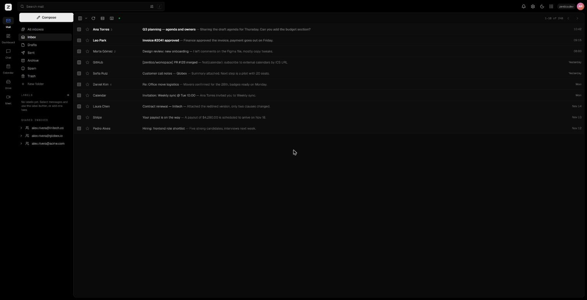
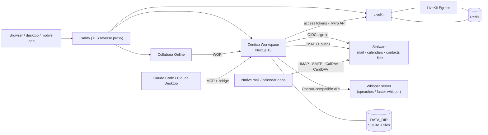

<div align="center">

<picture>
  <source media="(prefers-color-scheme: dark)" srcset="docs/assets/logo-animated-dark.svg">
  
</picture>

# Zentico Workspace

**A self-hosted workspace — mail, calendar, contacts, Drive, docs, chat and meetings — on top of
Stalwart, LiveKit and Collabora, with Claude built in through MCP.**


</div>

Zentico Workspace is the product layer only: it does not replace your mail, video or office
servers. [Stalwart](https://stalw.art) stores mail, calendars, contacts and files and handles
sign-in (OIDC); [LiveKit](https://livekit.io) carries meetings; [Collabora Online](https://www.collaboraoffice.com)
edits office documents. This Next.js app talks to them on the user's behalf and adds what they
don't have: chat, booking pages, a programmable dashboard, meeting transcripts and a Claude
integration. English and Spanish UI.

## Screenshots

| | |
| --- | --- |
|  |  |
| **Mail** | **Calendar** |
|  |  |
| **Chat** | **Dashboard** |
|  |  |
| **Booking page** | **Sign-in** |

<p align="center"><br><b>Desktop and mobile apps</b></p>

## Features

### Mail
- Threaded conversations, sanitized HTML in a sandboxed frame, remote images blocked by default.
- Compose, reply, forward, rich text, attachments, autosaved drafts, send-as identity per domain.
- Archive / spam / move / star, labels, multi-select, unified inbox across accounts, full-text search.
- Live updates over JMAP push, keyboard shortcuts (`c`, `r`, `a`, `f`, `e`, `j`/`k`, `/`, `?`…).
- Signatures, vacation responder and Sieve filters in settings.

### Calendar
- Day, week, month and agenda views; drag to create and move; time zones and reminders.
- Guests, invitations and RSVPs over iTIP/iMIP; one-click video meeting on any event.
- **Booking pages** (Calendly-style): public pages per meeting type, free/busy only (never event
  details), double-booking protection, confirmation mail with an `.ics` invite, manage/cancel links.
- **Subscriptions**: subscribe to external calendars by ICS URL (feed URLs stored encrypted) and
  import `.ics` files.

### Contacts
- Address books, groups, search, quick-compose, autocomplete in mail, export.

### Drive and Docs
- Files and folders on Stalwart (JMAP FileNode), uploads with progress, previews.
- Documents, spreadsheets and presentations in **Collabora Online** (this app is the WOPI host).
- Markdown documents and an Excalidraw whiteboard.

### Chat
- DMs, groups and teams with public/private channels; threads, reactions, mentions, edits, unread state.
- Attachments, Drive file sharing, **shared tasks** with assignees, due dates and subtasks.
- Ringing **calls** and "Meet now" in any conversation; scheduling straight into the calendar.
- Bots and apps: HTTP apps, incoming webhooks, and each person's own Claude.

### Meet
- LiveKit video meetings: pre-join, grid/speaker layouts, screen share, in-call chat, shareable links.
- **Recordings** (audio, and video through LiveKit Egress) with **transcripts** from a self-hosted
  Whisper server.
- **"Claude, …" voice commands**: opt-in per participant; a command only reaches the speaker's own
  Claude, and writes need the speaker's confirmation. Speech can be transcribed in the browser
  (WebGPU) so only text leaves the device.

### Dashboard and mods
- The Dashboard is built from plain files in the user's own Drive (`Zentico UI/`): layout, theme,
  keyboard shortcuts, widgets and **mods** (sandboxed HTML/CSS/JS with a permissioned `zentico.*` SDK).
- Validated on every change with undo snapshots; a workspace gallery of layouts and mods; an
  optional workspace-wide theme.
- Mods can call the user's connected MCP servers through the host, with per-tool consent
  (see [docs/user-mcp.md](docs/user-mcp.md)).

### Claude and MCP
- A remote **MCP server** at `/api/mcp` (Streamable HTTP) exposing mail, calendar, contacts, Drive,
  docs, chat, tasks, meetings and dashboard tools.
- Personal access tokens (read or read+write, optional expiry, shown once, stored hashed) with rate
  limits and an audit log, created in **Settings → Apps & bots**.
- A local **bridge** (`tools/zentico-bridge.mjs`, Node 18+, no dependencies) runs the user's own
  Claude Code for meeting voice commands and the Dashboard chat — no server-side agent.
- **Connected apps**: GitHub, Google, Atlassian, Notion and Slack via OAuth, and any remote MCP server
  the user adds.

### Security
- One login: the user's email address and password, through OIDC (authorization code + PKCE) against Stalwart.
- OAuth tokens never reach the browser; the session is an AES-GCM encrypted, httpOnly cookie.
- Two-step verification (TOTP, enforced by Stalwart) and app passwords; admins can require 2FA for everyone.
- Secrets at rest (feed URLs, refresh tokens, bot signing secrets) are sealed with AES-256-GCM;
  API tokens are stored as SHA-256 hashes.

### Desktop and mobile
- Thin native shells around your workspace URL: **Tauri v2** for Windows/macOS and **Capacitor 8**
  for Android/iOS, with native notifications. See [apps/README.md](apps/README.md).

## Architecture



- The app keeps its own state in SQLite files under `DATA_DIR` (Node's built-in `node:sqlite`):
  chat, meetings, MCP tokens, booking pages, calendar subscriptions, dashboard, security policy.
- Live features (chat, notifications, calls) use an in-process event bus over SSE, so **run a
  single app instance**.
- Collabora reaches the app's WOPI endpoint (`/api/wopi`); when Collabora only allows another host,
  set `WOPI_BASE_URL` to a proxied path on that host (for example on a Nextcloud domain).

## Tech stack

Next.js 15 (App Router, standalone output) · React 19 · TypeScript (strict) · Tailwind CSS 4 ·
next-intl · `node:sqlite` · `@modelcontextprotocol/sdk` · `livekit-client` · Excalidraw ·
transformers.js (in-browser Whisper) · Tauri v2 · Capacitor 8.

## Self-hosting

> [!NOTE]
> This repository contains the web app and its `Dockerfile`. The compose file and proxy
> configuration for Stalwart, LiveKit, Egress, Redis, Whisper, Collabora and Caddy are **not
> included yet** (TODO). The steps below describe what the app needs from them.

### 1. Prerequisites

| Service | Needed for | Required |
| --- | --- | --- |
| Stalwart (with OIDC) | sign-in, mail, calendar, contacts, Drive | yes |
| Reverse proxy with TLS (e.g. Caddy) | HTTPS for the app and its services | yes |
| LiveKit (+ Egress and Redis for video recording) | Meet, calls | no |
| Collabora Online | office documents | no |
| Whisper server with an OpenAI-compatible API | meeting transcripts, voice commands | no |

Optional services are detected from the environment; when one is missing the related screen says
it isn't configured.

### 2. DNS

Point a hostname at your proxy for each public service, for example `workspace.example.com` (this
app), `mail.example.com` (Stalwart), `meet.example.com` (LiveKit) and `office.example.com` (Collabora),
plus the usual mail records (MX, SPF, DKIM, DMARC) that Stalwart documents.

### 3. OIDC client in Stalwart

Create an OAuth client in Stalwart for this app:

- **Client ID**: e.g. `zentico-workspace` (→ `OIDC_CLIENT_ID`), with a client secret (→ `OIDC_CLIENT_SECRET`).
- **Redirect URI**: `https://<your app host>/api/auth/callback`.
- **Scopes**: `openid`, `offline_access`, the mail / contacts / calendars / files scopes, and
  Stalwart's **security** scope (used for two-step verification, app passwords, MCP tokens and
  booking pages).

TODO: step-by-step screenshots of the Stalwart admin UI.

### 4. Configuration

Copy [`.env.example`](.env.example) and fill it in. Required:

| Variable | Description |
| --- | --- |
| `OIDC_ISSUER` | Stalwart's public URL, e.g. `https://mail.example.com` |
| `OIDC_CLIENT_ID` / `OIDC_CLIENT_SECRET` | the client from step 3 |
| `APP_URL` | public URL of this app (used for the OAuth redirect) |
| `SESSION_SECRET` | random string of at least 32 characters, e.g. `openssl rand -base64 48` |

Optional: `LIVEKIT_URL` / `LIVEKIT_API_KEY` / `LIVEKIT_API_SECRET`, `EGRESS_ENABLED`,
`COLLABORA_URL`, `WOPI_BASE_URL`, `WHISPER_URL` / `WHISPER_MODEL` / `WHISPER_LANGUAGE`, `DATA_DIR`,
`CHAT_DB_PATH`, `CHAT_FILES_DIR`, `WORKSPACE_ADMINS`, `ORG_DOMAINS`, `BUILD_ID` and the
`CONNECT_<PROVIDER>_CLIENT_ID` / `_SECRET` pairs for connected apps. Each is documented in `.env.example`.

### 5. Build and run

```bash
docker build -t zentico-workspace .
docker run -d --name zentico-workspace \
  --env-file .env \
  -v zentico-data:/app/data \
  -p 3000:3000 \
  zentico-workspace
```

The image is a Next.js standalone build on `node:24-alpine`, runs as a non-root user and listens
on port 3000. Mount a persistent volume at `/app/data` (the default `DATA_DIR`). Put it behind your
TLS proxy at the `APP_URL` host.

## Development

Requires Node.js 24 (the app uses the built-in `node:sqlite` module) and a reachable Stalwart server
with an OIDC client whose redirect URI is `http://localhost:3000/api/auth/callback`.

```bash
npm install
cp .env.example .env.local   # then fill in the required values
npm run dev                  # http://localhost:3000 (Turbopack)
```

| Script | |
| --- | --- |
| `npm run dev` | development server |
| `npm run build` / `npm start` | production build / server |
| `npm run typecheck` | `tsc --noEmit` |
| `npm run lint` | `next lint` |

Project layout: `src/app` (routes and API), `src/lib` (server logic per area), `src/components`,
`messages/` (EN/ES translations), `tools/` (the Claude bridge), `scripts/` (maintenance scripts),
`apps/` (desktop and mobile shells), `docs/`.

## Desktop and mobile apps

The native apps are thin shells that ask for the workspace URL on first launch. Build instructions,
signing and platform notes are in [apps/README.md](apps/README.md). Installers can be offered from
the app's download page by placing them in `DATA_DIR/downloads` (they are not stored in git).

## Security

Please report vulnerabilities privately through GitHub's
[security advisories](https://github.com/antonyjaen/zentico-workspace/security/advisories/new)
rather than in public issues.

## Contributing

Issues and pull requests are welcome. Before opening a pull request, run `npm run typecheck` and
`npm run lint`, keep changes focused, and explain the reason for the change in the commit message.
UI text goes through `messages/` in both English and Spanish.

## License

TODO: no license has been chosen yet. Until one is added, all rights are reserved.
